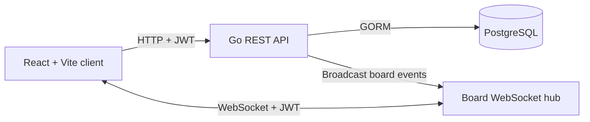

# Real-Time Collaborative Kanban

A full-stack Kanban workspace for creating boards, organizing work into columns, and collaborating with teammates. Task changes are persisted through a REST API and broadcast to connected board members over WebSockets.

## Highlights

- JWT-based registration, login, and authenticated API requests.
- Boards with admin/member roles, member invitations, and default workflow columns.
- Tasks with priority, assignee, due date, and fractional ordering.
- Drag-and-drop between and within columns with optimistic updates and rollback on failure.
- Board-scoped real-time updates for tasks, columns, and membership.
- Responsive React interface and a Docker Compose setup for the complete stack.

## Architecture



The Go service is organized into HTTP handlers, services, repositories, and GORM models. Services enforce membership and role checks before repository changes. The same service methods broadcast a board event after a successful mutation. PostgreSQL is migrated from the Go model definitions at startup.

### Real-time and concurrency flow

1. The browser requests `GET /ws/boards/:id?token=<JWT>`. The server validates the JWT and board membership before upgrading the connection.
2. The WebSocket handler registers the client in a room keyed by board ID. Each client has a buffered outbound queue; its read and write pumps run independently.
3. REST mutations (for example task move or column creation) persist first, then publish an event envelope: `{ "event": "TASK_MOVED", "payload": {...}, "sender_id": 12 }`.
4. The hub marshals each event once and queues it for all clients in that board room. A slow client is disconnected rather than blocking broadcasts to the rest of the room. A write pump serializes event and heartbeat writes.
5. The frontend reconnects with exponential backoff and applies events idempotently by record ID. It reconciles the sender's own events with optimistic/API updates, and refreshes board data after a reconnect to recover missed events.

Supported events: `TASK_CREATED`, `TASK_UPDATED`, `TASK_DELETED`, `TASK_MOVED`, `COLUMN_CREATED`, `COLUMN_UPDATED`, `COLUMN_DELETED`, and `MEMBER_ADDED`.

## Tech stack

| Layer | Technologies |
| --- | --- |
| Frontend | React, Vite, Tailwind CSS, React Router |
| Interaction | dnd-kit, Lucide icons |
| API client | Axios with JWT bearer-token interceptor |
| Backend | Go, Gin, GORM, Gorilla WebSocket |
| Authentication | JWT |
| Database | PostgreSQL |
| Containerization | Docker, Docker Compose, Nginx |

## Data model

| Entity | Important fields and relationships |
| --- | --- |
| `users` | Name, unique email, password hash (never serialized), optional avatar URL |
| `boards` | Title, description, owner; has members and ordered columns |
| `board_members` | Composite board/user membership, role (`admin` or `member`) |
| `columns` | Board, title, numeric position; deleting a column cascades to its tasks |
| `tasks` | Column, title, description, priority, numeric position, optional assignee and due date |

Every new board receives `To Do`, `In Progress`, and `Done` columns and its creator is added as an admin. Task and column positions use numeric gaps to allow insertion between neighboring items without reordering every row.

## Run the complete stack with Docker

Prerequisites: Docker Engine/Desktop with the Docker Compose plugin.

From the repository root:

```sh
docker compose up --build
```

Then open:

- Frontend: <http://localhost:5173>
- API health check: <http://localhost:8080/health>
- PostgreSQL: `localhost:5432` (development credentials default to `postgres` / `postgres`)

Register an account in the UI to create a board. The backend waits for PostgreSQL health and applies migrations on startup. Database data persists in the `postgres_data` volume.

For local development, create a root `.env` file to override Compose defaults. At minimum, set a private `JWT_SECRET` and a database password before exposing the services:

```dotenv
JWT_SECRET=replace-with-a-long-random-secret
DB_PASSWORD=replace-with-a-strong-password
```

Compose supports `FRONTEND_PORT`, `API_PORT`, and `POSTGRES_PORT` for host port changes. `VITE_API_URL` and `VITE_WS_URL` are build-time browser URLs; for a remote deployment they must point to public API/WebSocket endpoints reachable by the user's browser. Set `ALLOWED_ORIGINS` to the frontend origin. Use `wss://` behind TLS in production.

## Run services locally without containerizing the app

Prerequisites: Go 1.26+, Node.js 22+, npm, and PostgreSQL.

1. Start PostgreSQL and create a database/user for the app. The backend's local defaults expect PostgreSQL at `localhost:5431`; set `DB_PORT` in `backend/.env` if yours uses another port.
2. Copy `backend/.env.example` to `backend/.env`, set `JWT_SECRET`, and update the database values.
3. In a terminal, start the API:

   ```sh
   cd backend
   go run ./cmd/api
   ```

4. In another terminal, install frontend dependencies and start Vite:

   ```sh
   cd frontend
   npm ci
   npm run dev
   ```

5. Open <http://localhost:5173>. The default frontend API and WebSocket URLs target `localhost:8080`.

## Verification

```sh
cd backend
go test ./...

cd ../frontend
npm ci
npm run build
```

## API overview

The API is rooted at `/api`. Authentication endpoints are `POST /auth/register`, `POST /auth/login`, and `GET /auth/me`. Protected board endpoints cover board listing/creation/detail, member invitations, and column creation. Task create/update/delete and move operations are exposed under `/columns/:id/tasks` and `/tasks/:id`; moving uses `PATCH /tasks/:id/move` with `to_column_id` and `new_position`.

## Repository layout

```text
backend/    Go API, WebSocket hub, database models and migrations
frontend/   React application and Nginx production image
docker-compose.yml
```
